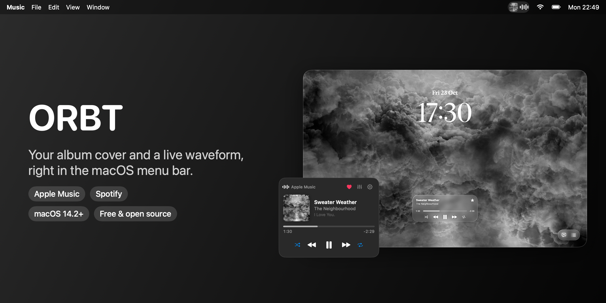
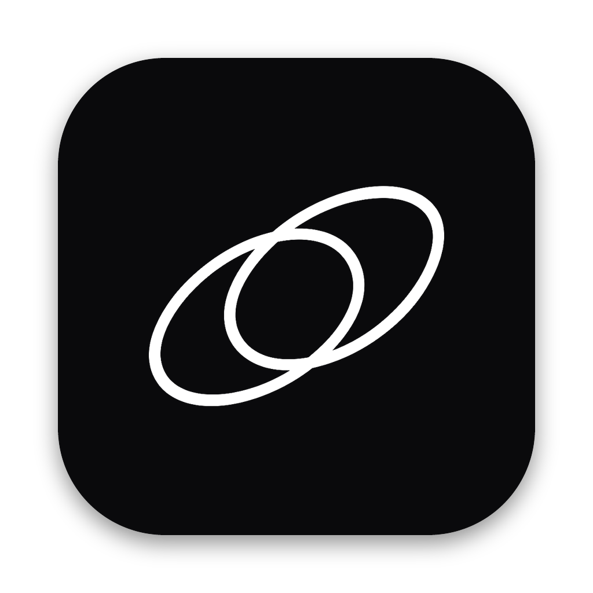
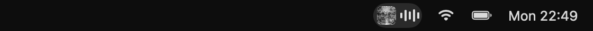
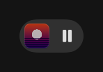
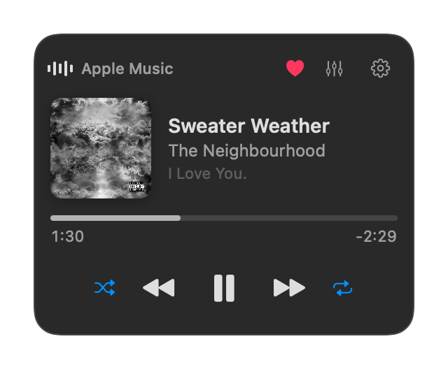
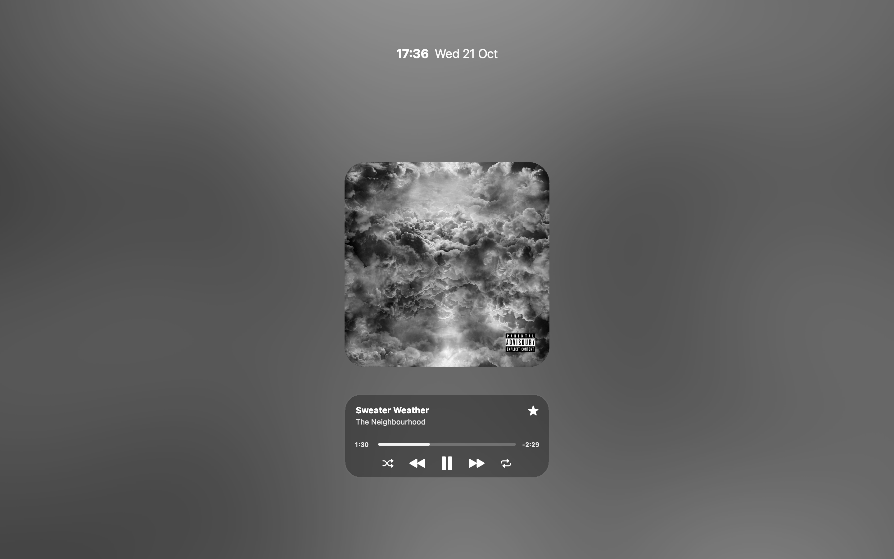

# MusicBar

**Your album cover in the macOS menu bar, with a waveform next to it.**

## Why

macOS shows a plain icon for Now Playing. MusicBar shows the **real cover** instead, like the iPhone's Dynamic Island. Click it for a small player.

 

 Playing · Paused
  

## On the lock screen

A player card sits above the macOS lock screen: cover, title, seek bar, shuffle / previous / play / next / repeat and a favourite star. Click the small cover for fullscreen: a big cover with a soft colour wash, or, when Apple has made **moving artwork** for the album, the video fills the whole screen.

 Rendered from the app's own views (the real lock screen shows your wallpaper and a glass blur behind the card).

## Features

- Real album art and an animated waveform in the menu bar
- Compact player: seek bar, previous / play / next, shuffle, repeat
- **Lock screen player** with a fullscreen mode and Apple's **moving artwork** (when the album has it)
- Favourite (star) and equalizer presets for Apple Music; optional Liquid Glass look on the lock screen (macOS 26+)
- Works with **Apple Music** and **Spotify**
- Light on resources (about 1% CPU while playing), no Dock icon, no audio recording

## Install

1. Download the zip from [Releases](https://github.com/Daniil15DDD/MusicBar/releases/latest) and unzip it.
2. Move `MusicBar.app` to Applications and right-click → **Open** (it is not notarized).
3. Allow it to control Music and Spotify when macOS asks.

Needs macOS 14.2+. For the newest features (lock screen player, moving artwork) build from source: `git clone` this repo, then `./build.sh` (Command Line Tools are enough).

## Good to know

- The waveform is a lively animation, not a real audio analysis, so nothing is listened to. An optional setting makes it react to live audio (macOS then asks for audio-capture permission).
- Favourite and equalizer are Apple Music only (Spotify has no like command in its scripting interface).
- The lock screen player uses undocumented macOS window calls, because Apple offers no official way to draw there. A macOS update could break it. Turn it off in Settings if you prefer.
- Moving artwork is read from Apple's public catalogue pages, which is unofficial. When an album has none, you get the normal cover.
- No song info? Check System Settings → Privacy & Security → Automation.

## Support

If you like it, you can support me on Ko-fi, and a star helps others find it.

MIT licensed. Inspired by iOS Now Playing and [Boring Notch](https://github.com/TheBoredTeam/boring.notch); no code copied. Album artwork shown in the images belongs to its owners.
